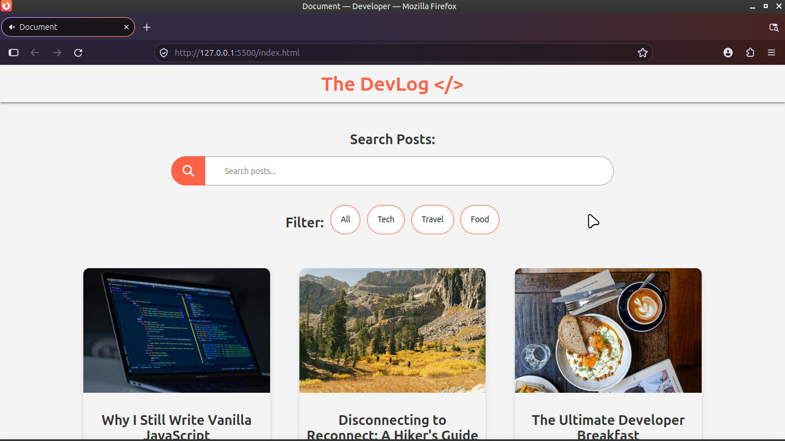
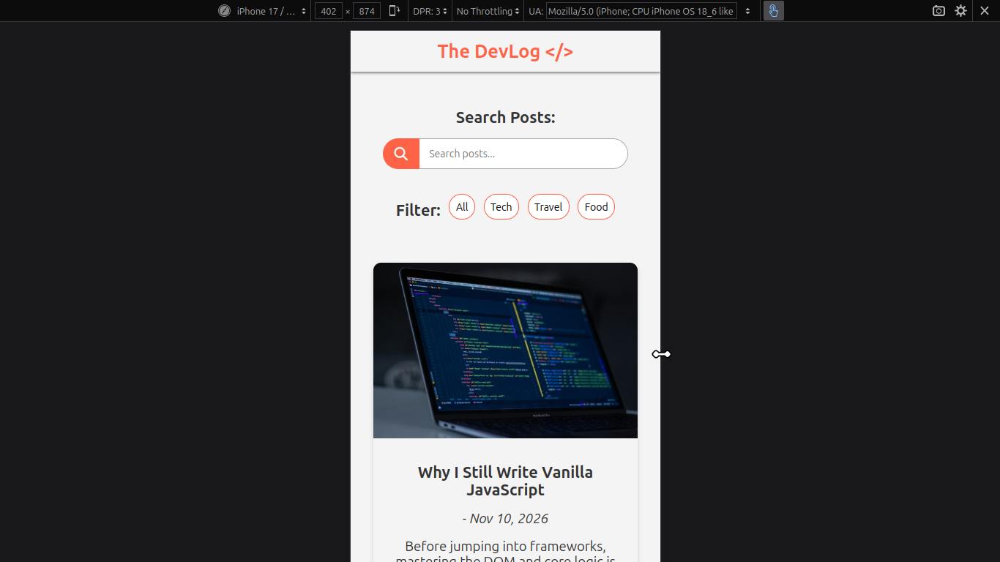

# Elevvo Task 4: Dynamic Blog Homepage

A fully responsive, data-driven blog homepage built from scratch using Vanilla JavaScript. This project focuses on DOM manipulation, array methods, and state management without the use of frameworks.

## Live Demo
[View the live blog here](https://markocira42-cmd.github.io/elevvo-blog/)

## Key Features
- **Dynamic Rendering:** Blog posts are stored in an array of objects and rendered to the DOM dynamically using `document.createElement()` (preventing XSS vulnerabilities).
- **Deep Search Functionality:** Users can search across all properties of a blog post (title, description, date, category) using `Object.values()` and `.includes()`.
- **Category Filtering:** Interactive filter buttons that use `.filter()` to display specific categories (Tech, Travel, Food).
- **Smart Initial Load:** The page limits the initial render to the first 3 posts using `.slice()` to keep the UI clean.
- **Responsive Grid:** Utilizes CSS Grid (`auto-fit`, `minmax`) to create a seamless masonry-style layout that adapts perfectly to any screen size.

## Architecture & Best Practices
- **Separation of Concerns:** The JavaScript is strictly organized into Global Variables, Modular Functions (Render, Highlight), and Event Listeners. 
- **Security First:** Strictly utilized `textContent` and `createElement` to build the DOM nodes, completely avoiding the XSS risks associated with `innerHTML`.
- **Accessibility:** Added `aria-label` attributes to generated links and search inputs to ensure screen-reader compatibility.
- **DRY Principle:** Reused functions like `unHighlightFilter()` to ensure a single source of truth for UI state.

## Tech Stack
- **HTML5:** Semantic structure and accessibility.
- **CSS3:** Custom properties (`:root`), CSS Grid, Flexbox, Media Queries, and `clamp()` for fluid typography.
- **Vanilla JavaScript (ES6+):** Array methods (`forEach`, `filter`, `slice`, `Object.values`), Event Listeners (`click`, `input`), and DOM manipulation.

## Screenshots

### Desktop View

### Mobile View

